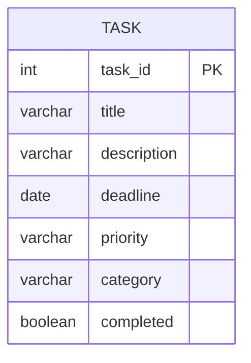

# Student Task Manager

A desktop app for students to keep track of assignments and personal tasks. It is built with **Java 17, JavaFX, JDBC and MySQL**, and the code is kept simple and well-commented so it is easy to explain.

## Features
- Add, edit and delete tasks. Each task has a title, description, deadline, priority (HIGH/MEDIUM/LOW) and category.
- Mark a task done or not done.
- Search the title and description, filter by category, priority or "hide completed", and sort by deadline, priority, title or category.
- Overdue tasks are highlighted in red, and the status bar shows how many are overdue.
- Every SQL query uses `PreparedStatement`, so it is safe from SQL injection.

## Architecture
```
ui (JavaFX)  ->  service (rules: validation, search, sort)  ->  dao (JDBC)  ->  MySQL
```
| Package | Classes | Job |
|---|---|---|
| `model` | `Task` (record), `Priority` | Plain data |
| `dao` | `TaskDao` (interface), `JdbcTaskDao`, `Database`, `DataAccessException` | All SQL lives here (DAO pattern) |
| `service` | `TaskService`, `TaskFilter` | Validation, search/filter/sort, overdue logic |
| `ui` | `TaskManagerApp`, `TaskForm` | JavaFX window and the add/edit dialog |

`TaskService` takes a `Clock`, so tests can pretend "today" is a fixed date.



## Run
Requirements: JDK 17+, Maven, Docker.
```bash
docker compose up -d      # starts MySQL and loads db/schema.sql (with 5 sample tasks)
mvn javafx:run            # opens the app
```
The connection settings are in `src/main/resources/db.properties`.

## Test
```bash
mvn test
```
The 13 JUnit 5 tests run against an **H2 in-memory database in MySQL mode** that uses the same `schema.sql`, so you don't need Docker to run them.
- `JdbcTaskDaoTest`: CRUD, ordering, and SQL-injection-safe text.
- `TaskServiceTest`: validation, search, filters, all sort orders, overdue logic and toggling done.
